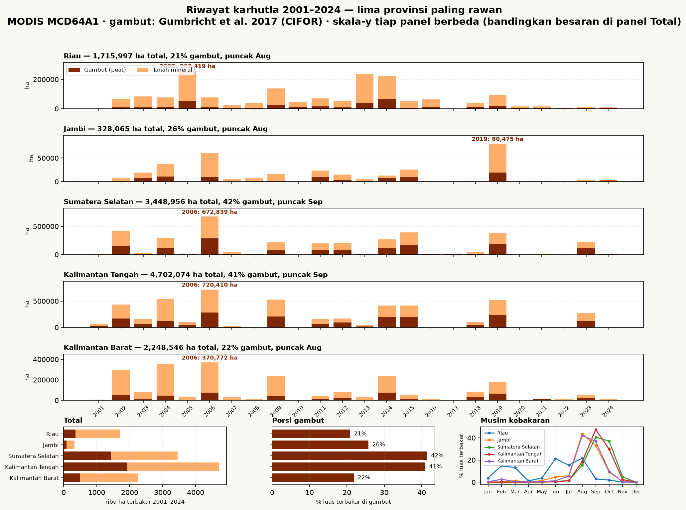
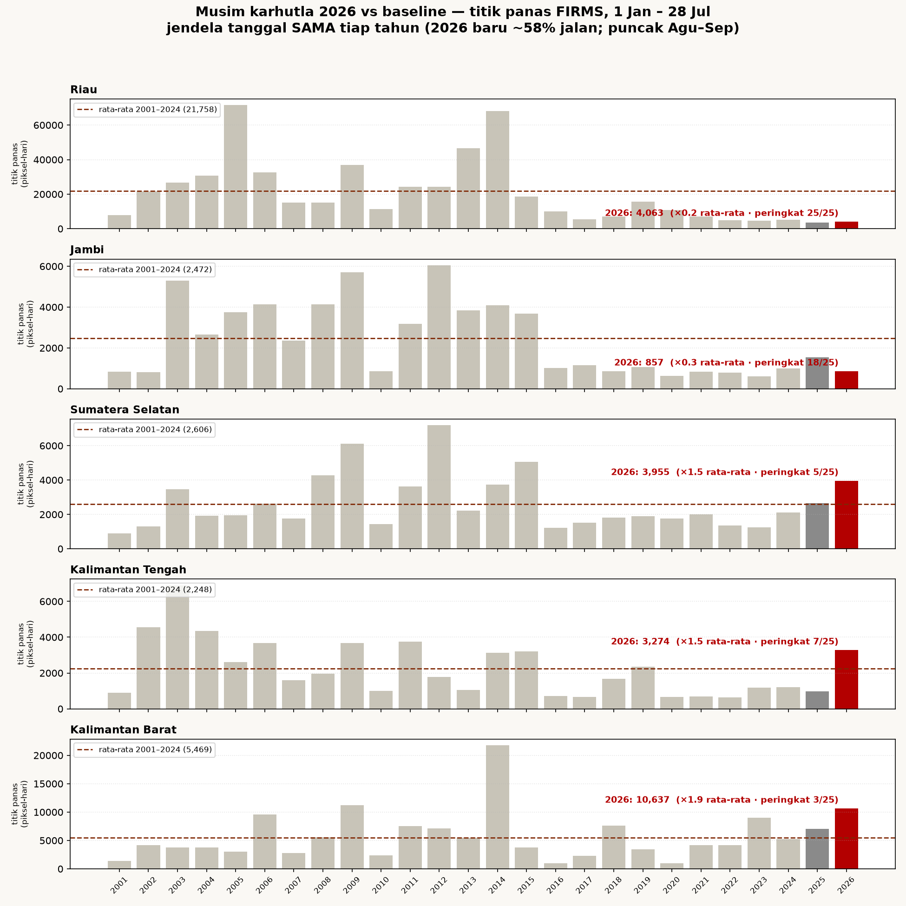

# Studi kasus: karhutla lima provinsi {#sec-karhutla-provinsi}

Setiap tahun, kira-kira mulai Agustus, linimasa saya penuh dua hal.

Yang pertama foto: langit oranye di Palangka Raya, jarak pandang tinggal ratusan
meter di Pontianak, anak-anak bermasker di halaman sekolah. Yang kedua perdebatan,
dan bunyinya selalu mirip. *"Tahun ini lebih parah dari tahun lalu."* Dibalas,
*"Ah tidak, 2015 jauh lebih parah."* Dibalas lagi, *"Itu karena media sekarang
kurang meliput."*

Yang menarik, perdebatan itu hampir selalu diselesaikan dengan perasaan. Dengan
ingatan. Dengan seberapa pekat asap di kota tempat kita kebetulan tinggal tahun itu.
Dan ingatan manusia soal bencana, kita tahu, bukan alat ukur yang bisa
diandalkan — ia dipengaruhi usia kita saat itu, apakah ada anggota keluarga yang
sakit, dan seberapa ramai berita mengangkatnya.

Padahal angkanya ada. Gratis. Sejak 2001. Dua puluh lima musim kemarau terekam
dari orbit, tersimpan rapi, menunggu ditanyai — dan hampir tidak pernah masuk ke
percakapan yang tadi.

Bab ini menelusuri satu investigasi utuh: menyusun rekaman kebakaran 2001–2024 di
lima provinsi paling rawan, lalu menempatkan musim 2026 yang sedang berjalan di
atas rekaman itu. Seluruhnya dari dua perintah. Waktu yang dibutuhkan lebih pendek
daripada perdebatan di kolom balasan.

## Menjalankan

```python
import earthchange as ec
lima = ec.run("fire-history", out_dir="karhutla-5-provinsi",
              areas="Riau,Jambi,Sumatera Selatan,Kalimantan Tengah,Kalimantan Barat",
              start_year=2001, end_year=2024,
              peat_file="TROP-SUBTROP_PeatV21_2016_CIFOR.tif")
```

::: {.callout-note}
## Gambar di bab ini
Gambar dan angka di Bagian III dibuat pada Juli 2026 dari run sungguhan dengan
pemanggilan yang tercetak, tetapi tidak dijalankan ulang setiap kali buku dirender:
run lima provinsi sejak 2001 makan waktu lama, dan kode Bagian II sudah menunjukkan
cara membaca setiap keluarannya. Peta gambut CIFOR perlu diunduh dulu (@sec-gambut).
:::

Dua hal yang perlu saya jelaskan dari pemanggilan itu, karena keduanya menentukan
seberapa jauh angkanya bisa dipercaya.

`areas` mengambil poligon provinsi dari FAO GAUL. Artinya batas yang dipakai
adalah batas provinsi sungguhan, bukan kotak persegi yang saya tarik sendiri di
peta. Ini penting kalau angkanya mau dibandingkan dengan statistik resmi — kotak
sembarang akan memotong sebagian Riau dan menyerobot sebagian Sumbar, dan
selisihnya tidak akan pernah bisa dijelaskan.

`peat_file` menunjuk ke peta gambut **Gumbricht dkk. 2017**. Kenapa peta itu dan
bukan yang lain, saya bahas panjang di Bab @sec-gambut — dan saya sarankan Anda
membacanya sebelum mengutip kolom "gambut" di tabel berikut, karena pilihan lapisan
ini bisa menggeser angkanya sampai empat kali lipat.

## Hasil

| Provinsi | Luas terbakar | Gambut | Tahun terparah | Puncak |
|----------|--------------:|-------:|----------------|--------|
| Kalimantan Tengah | 4.702.074 ha | 41% | 2006 (720.410) | Sep |
| Sumatera Selatan | 3.448.956 ha | 42% | 2006 (672.839) | Sep |
| Kalimantan Barat | 2.248.546 ha | 22% | 2006 (370.772) | Agu |
| Riau | 1.715.997 ha | 21% | 2005 (258.419) | Agu |
| Jambi | 328.065 ha | 26% | 2019 (80.475) | Agu |

{#fig-5provinsi}

Angka pertama yang saya pandangi agak lama: **4,7 juta hektar di Kalimantan Tengah**.
Itu kira-kira seluas Provinsi Jawa Barat. Memang bukan berarti 4,7 juta hektar lahan
yang berbeda-beda — banyak petak terbakar berulang kali dalam dua puluh empat tahun,
dan itu sendiri sudah cerita tersendiri. Tapi sebagai gambaran seberapa besar
persoalannya, angka itu cukup membuat diam.

Dari keseluruhan hasilnya, tiga temuan yang menurut saya paling layak diceritakan.

### Porsi gambut membelah kelompok ini jadi dua

Sumsel (42%) dan Kalteng (41%) terbakar kira-kira dua kali lebih "bergambut"
dibanding Riau, Kalbar, dan Jambi yang berkisar 21–26%. Dan menariknya, dua provinsi
itu juga yang totalnya terbesar.

Saya sempat mengira porsi gambut akan kurang lebih seragam di lima provinsi ini —
toh semuanya dikenal sebagai provinsi gambut. Ternyata tidak. Kebakaran gambut
terkonsentrasi, bukan tersebar merata. Ini punya konsekuensi kebijakan yang cukup
langsung: kalau prioritas pemulihan disusun berdasarkan luas terbakar saja,
urutannya akan berbeda dari kalau disusun berdasarkan luas gambut terbakar. Dan
untuk emisi karbon, yang kedualah yang lebih relevan.

Satu pengingat sebelum Anda memakai kolom itu: angka 41% dan 21% ini melekat pada
lapisan Gumbricht. Ditukar lapisannya, urutannya bisa berubah. Sekali lagi, Bab
@sec-gambut.

### Riau bermusim berbeda dari yang lain

Kurva musim Riau **bimodal** — ada dua puncak, Februari–Maret dan Agustus —
sementara empat provinsi lain berpuncak tunggal di Agustus–September.

Ini bukan keanehan data, dan sudah lama diketahui orang yang bekerja di sana: Riau
punya pola hujan yang berbeda dari Sumatera bagian selatan dan Kalimantan. Tapi
melihatnya muncul sendiri dari dua puluh empat tahun data, tanpa saya beri tahu
apa-apa ke programnya, tetap terasa menyenangkan.

Konsekuensi praktisnya nyata: kalender siaga karhutla yang seragam nasional akan
selalu terlambat untuk Riau di awal tahun. Kalau Anda menyusun jadwal patroli atau
kesiapsiagaan, kurva musim per provinsi ini jauh lebih berguna daripada satu
kalender untuk semua.

### 2006, bukan 2015, adalah tahun terluas

Ini temuan yang paling membuat saya berhenti, dan yang paling perlu hati-hati
disampaikan.

Kita semua ingat 2015 sebagai krisis asap terburuk. Sekolah libur berminggu-minggu,
penerbangan batal, ada korban jiwa, dan istilah "kabut asap" masuk ke percakapan
nasional dengan cara yang tidak pernah terjadi sebelumnya. Ingatan itu benar.

Tapi di data ini, tahun terluas untuk empat dari lima provinsi adalah **2006**.

Apakah berarti ingatan kita salah? Tidak. Yang terjadi, ingatan kolektif dan angka
satelit ini sedang mengukur dua hal yang berbeda, dan keduanya sama-sama sah.

Yang diingat orang dari 2015 adalah **emisi dan durasi asap** — dan itu terutama
datang dari gambut yang membara di bawah permukaan, berminggu-minggu, kadang
berbulan-bulan. Api semacam itu bisa menghasilkan asap luar biasa banyak dari
hamparan yang tidak seberapa luas. Sementara yang diukur MCD64A1 adalah **luas
permukaan yang hangus dan terpetakan**. Dua besaran berbeda; tidak ada alasan
keduanya harus sejalan.

Ada lapisan kedua yang lebih menggelitik. Asap 2015 itu sendiri **menghalangi
satelit melihat ke bawah**. Artinya, pada tahun yang asapnya paling pekat, MODIS
justru punya kesempatan paling sedikit untuk memetakan area yang terbakar. Sensor
itu paling buta persis ketika ada paling banyak yang harus dilihat.

Jadi kalau Anda mengutip tabel di atas, tolong jangan berhenti di "2006 lebih parah
dari 2015". Kalimat itu benar untuk satu besaran dan menyesatkan untuk hampir semua
maksud lain yang mungkin Anda punya.

::: {.callout-note}
## Catatan resolusi
Kalteng dan Kalbar terlalu besar untuk diunduh pada 500 m, sehingga otomatis
dikasarkan ke **1 km**. Presisi luasnya sedikit berbeda dari tiga provinsi Sumatera.

Saya memilih menampilkan ini di teks utama, bukan di catatan kaki, karena inilah
jenis detail yang biasanya rontok pertama kali saat angka berpindah ke slide.
Tercatat di keluaran, dan tercatat di sini.
:::

## Musim 2026 terhadap baseline

Sekarang bagian yang sebenarnya memicu seluruh pekerjaan ini. Rekaman panjang itu
menarik, tapi pertanyaan yang orang ajukan saat asap sedang mengepul selalu
pertanyaan sekarang: **tahun ini bagaimana?**

```python
musim = ec.run("fire-history", out_dir="karhutla-musim-berjalan",
               areas="Riau,Jambi,Sumatera Selatan,Kalimantan Tengah,Kalimantan Barat",
               start_year=2001, vs_baseline=True)
```

Satu hal yang harus benar di sini, dan sering salah di perbandingan yang beredar:
membandingkan **jendela tanggal yang sama**. Musim 2026 baru sampai akhir Juli, jadi
membandingkannya dengan total setahun penuh tahun-tahun sebelumnya jelas tidak adil
— dan akan selalu membuat tahun berjalan terlihat lebih ringan daripada
sebenarnya. Angka di bawah ini membandingkan 1 Januari – 28 Juli 2026 dengan 1
Januari – 28 Juli di tiap tahun sebelumnya.

| Provinsi | 2026 | vs rata-rata 2001–24 | vs **2016–25** | Peringkat |
|----------|-----:|---------------------:|---------------:|-----------|
| Kalimantan Barat | 10.637 | ×1,9 | **×2,4** | **3 dari 26** |
| Kalimantan Tengah | 3.274 | ×1,5 | **×3,0** | 7 dari 26 |
| Sumatera Selatan | 3.955 | ×1,5 | **×2,3** | 5 dari 26 |
| Jambi | 857 | ×0,3 | ×0,9 | 19 |
| Riau | 4.063 | ×0,2 | ×0,5 | 25 |

{#fig-2026}

Perhatikan dua kolom di tengah. Keduanya menghitung hal yang sama dari data yang
sama — dan hasilnya berbeda cukup jauh. Kalteng "×1,5 dari normal" atau "×3,0 dari
normal", tergantung normal yang mana yang Anda pakai.

Ini bukan sekadar rewel soal metode. Selisih antara "satu setengah kali normal" dan
"tiga kali normal" adalah selisih antara berita yang lewat begitu saja dan berita
yang membuat orang mengangkat telepon.

::: {.callout-important}
## Rata-rata panjang meremehkan anomali
Penyebabnya: ada **patahan rezim** setelah krisis 2015. Sesudah tahun itu — dengan
moratorium, restorasi gambut, penegakan hukum, dan entah faktor apa lagi yang
belum terurai — semua provinsi ini turun tajam. Riau **−75%**, Jambi −72%, Kalteng
−63%, Sumsel −45%, dan Kalbar hanya **−28%**.

Artinya rata-rata 2001–2024 mencampur dua dunia yang berbeda: dunia sebelum 2015
dan dunia sesudahnya. Sebuah musim yang tiga kali lebih buruk dari normal
*sekarang* akan terlihat cuma satu setengah kali lipat, karena angka pembandingnya
diseret naik oleh tahun-tahun 2000-an yang jauh lebih ganas.

Diukur terhadap dekade *terakhir*, ketiga provinsi yang terbakar berjalan pada
**2,3–3,0× normal**, bukan 1,5×. Kalteng adalah anomali relatif terbesar (×3,0);
Kalbar terbesar secara absolut — awal musim terburuk ke-3 dalam 26 tahun.

Dan ada catatan yang tidak nyaman di angka Kalbar: dari lima provinsi, Kalbarlah
yang perbaikannya paling kecil sejak 2015 (−28%). Provinsi yang paling sedikit
membaik itu pula yang sekarang terbakar paling parah. Saya tidak akan mengklaim
hubungan sebab-akibat dari satu tabel, tapi kebetulan ini rasanya layak
diperhatikan orang yang lebih tahu daripada saya.
:::

Lalu ada satu temuan yang sama sekali tidak muncul di pemberitaan mana pun yang
saya baca: **Riau justru sedang menjalani awal musim paling sepi dalam 26 tahun**.
Peringkat 25 dari 26. Seperlima dari rata-rata jangka panjangnya.

Riau adalah provinsi yang paling identik dengan karhutla di kepala kebanyakan orang
Indonesia. Kalau ada asap, kita mengira Riau. Tahun ini, tidak. Musim 2026
benar-benar berpusat di Kalimantan.

Menyebutnya "karhutla nasional" — sebutan yang otomatis kita pakai setiap Agustus —
tahun ini tidak tepat, dan ketidaktepatan itu ada harganya. Perhatian, anggaran,
dan armada pemadam yang tersebar merata "karena ini masalah nasional" adalah sumber
daya yang tidak sampai ke Kubu Raya.

## Verifikasi silang

Satu kebiasaan yang selalu saya usahakan sebelum membagikan angka apa pun: cari
apakah ada yang melihat hal yang sama dari darat.

Untuk kasus ini, ada. Akhir Juli 2026, BPBD Kalimantan Barat menetapkan **siaga
darurat bencana asap hingga 15 November 2026**, setelah BMKG mendeteksi **200 titik
panas tersebar di 12 kabupaten**. Tiga teratas: Kubu Raya (64), Ketapang (56), dan
Kayong Utara (53).

Cocok. Provinsi yang menurut satelit sedang menjalani awal musim terburuk ketiga
dalam 26 tahun adalah provinsi yang menetapkan siaga darurat. Kalau keduanya tidak
cocok, saya akan menghabiskan sore memeriksa ulang perintah saya sebelum berani
menerbitkan apa pun.

Kenapa langkah ini penting? Karena keduanya buta pada hal yang berbeda.

Data satelit memberi konteks historis yang tidak dimiliki berita. Berita bisa
bilang "200 titik panas" — tapi 200 itu banyak atau sedikit? Dibanding tahun lalu
bagaimana? Dibanding dua puluh lima tahun terakhir, ini peringkat berapa? Tanpa
konteks itu, angka 200 cuma terdengar besar, dan "terdengar besar" bukan dasar
pengambilan keputusan.

Sebaliknya, berita memberi hal yang tidak mungkin dilihat dari orbit: siapa yang
sudah bertindak, kabupaten mana yang paling terdampak menurut orang yang tinggal di
sana, dan status kebijakan apa yang sudah berlaku. MODIS tidak tahu apa-apa soal
surat keputusan siaga darurat.

Keduanya saling menambal. Sendiri-sendiri, keduanya timpang.
