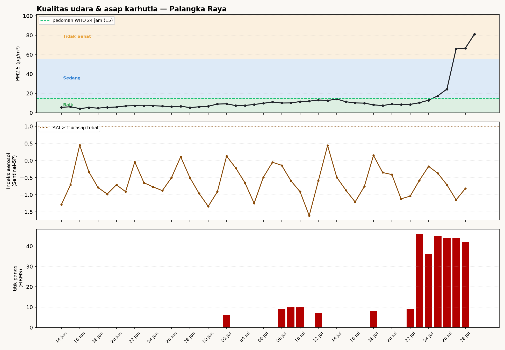
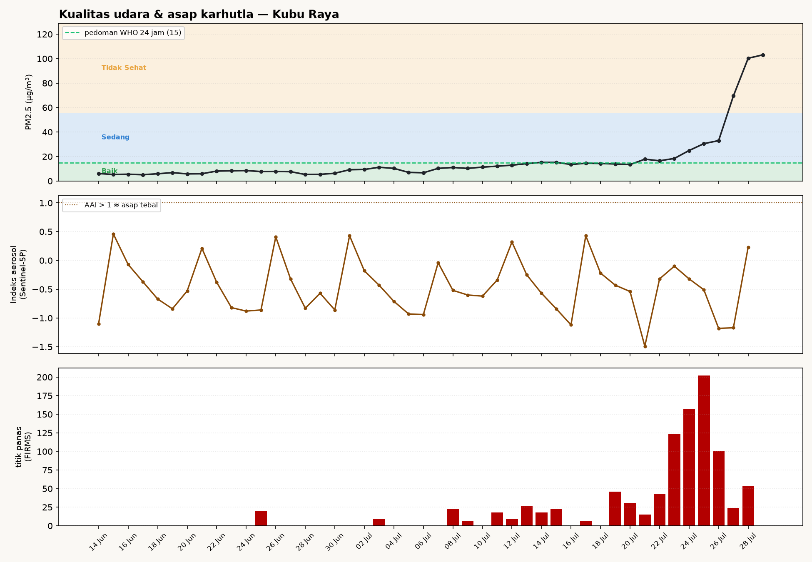

# Studi kasus: asap Palangka Raya {#sec-asap}

Bab ini bermula dari satu kalimat: *"Di Palangkaraya, hampir seminggu kualitas
udaranya buruk."*

Itu saja. Tidak ada angka, tidak ada tautan, tidak ada grafik, tidak ada rentang
tanggal. Cuma keterangan dari seseorang yang menghirup udaranya setiap hari.

Kalau dinilai dengan standar ilmiah yang ketat, kalimat itu nyaris tidak ada
nilainya. Tidak bisa diverifikasi, tidak terkuantifikasi, sumbernya tunggal. Dan
justru di situlah letak persoalannya — karena **itulah bentuk data yang paling
sering sampai ke kita**. Bukan tabel, bukan CSV. Keluhan. Pesan singkat. Foto langit
oranye tanpa keterangan waktu. Cerita di ruang tunggu puskesmas.

Kita punya dua pilihan menghadapi data semacam itu. Mengabaikannya karena "tidak
ilmiah" — yang sopan tapi malas, dan sering keliru. Atau memperlakukannya sebagai
apa adanya: **sebuah hipotesis yang layak diuji**, disampaikan oleh orang yang
kebetulan berada jauh lebih dekat ke kejadian daripada kita.

Saya pilih yang kedua. Pertanyaannya jadi: bisakah satelit membenarkan keterangan
itu? Kalau bisa, seberapa tepat? Dan seberapa cepat kita bisa tahu — dalam hitungan
menit, atau harus menunggu laporan resmi bulan depan?

Bab ini menelusuri jawabannya, lalu menghubungkan asapnya dengan api yang
menyebabkannya.

## Menjalankan

```python
import earthchange as ec
ec.run("haze", out_dir="haze-palangka-raya", lat=-2.21, lon=113.92, radius=30, days=45,
       name="Palangka Raya")
```

Satu perintah, tiga sumber data yang dirangkai jadi satu cerita: PM2.5 dari model
atmosfer CAMS, indeks aerosol dari Sentinel-5P, dan titik panas dari FIRMS. Yang
`days=45` itu penting — saya ingin melihat cukup banyak hari **sebelum** episodenya
supaya ada pembanding. Grafik yang cuma menampilkan minggu buruknya saja akan
membuat semua hari terlihat buruk.

## Rantai sebab-akibat

{#fig-plk}

Yang saya cari di grafik ini bukan sekadar "apakah PM2.5 tinggi", melainkan
**urutan kejadiannya**. Kalau ceritanya benar, apinya harus muncul lebih dulu, baru
asapnya. Kalau terbalik, ada yang salah — entah dengan datanya, entah dengan
penafsiran saya.

| Tanggal | PM2.5 (µg/m³) | Kategori ISPU |
|---------|--------------:|---------------|
| 14 Jun – 21 Jul | 5 – 14 | Baik |
| 24 Jul | 15,6 | melewati pedoman WHO |
| 26 Jul | 24,4 | Sedang |
| 27 Jul | 67,9 | **Tidak Sehat** |
| 28 Jul | 67,0 | **Tidak Sehat** |
| **29 Jul** | **81,1** | **Tidak Sehat** |

Perhatikan baris pertama dulu. Lima setengah minggu — dari pertengahan Juni sampai
21 Juli — udara Palangka Raya **baik-baik saja**. PM2.5 di kisaran 5–14 µg/m³,
seluruhnya di bawah pedoman WHO. Ini bukan kota yang memang selalu berpolusi. Ini
kota yang udaranya normal, lalu berubah.

Lalu, **22 Juli: titik panas melonjak dari nyaris nol menjadi 36–46 per hari.**
Bukan naik perlahan — melompat.

PM2.5 melewati pedoman WHO dua hari kemudian, 24 Juli. Masuk kategori Sedang pada
26 Juli. Masuk **Tidak Sehat** pada 27 Juli, dan bertahan di situ. Pada 29 Juli
angkanya 81,1 µg/m³ — **5,4 kali pedoman WHO untuk paparan 24 jam** — dan grafiknya
masih menanjak, belum menunjukkan tanda melandai.

Api dulu, jeda dua hari, baru asap. Urutannya masuk akal secara fisik, dan itu
melegakan. Sinyal seperti ini yang membuat saya cukup percaya diri untuk
membagikan hasilnya; kalau asapnya muncul lebih dulu, saya akan menghabiskan sisa
sore memeriksa ulang kode.

Dan keterangan yang mengawali bab ini tadi? *"Hampir seminggu kualitas udaranya
buruk."*

Mari kita hitung: 24 Juli udara mulai memburuk, 29 Juli masih memburuk. Enam hari.
Tiga di antaranya kategori Tidak Sehat.

Cocok. Nyaris persis. Tanpa alat ukur, tanpa aplikasi, tanpa stasiun pemantau —
cuma dengan menghirupnya. Saya menulis ini bukan sebagai basa-basi manis: kalau
suatu saat data satelit Anda bertabrakan dengan keterangan orang yang tinggal di
lokasi, jangan buru-buru menyimpulkan orangnya yang keliru. Hidung mereka
terkalibrasi oleh pengalaman bertahun-tahun di tempat yang sama.

## Kubu Raya: lebih parah lagi

Setelah Palangka Raya, wajar kalau perhatian bergeser ke Kalimantan Barat —
provinsi yang di Bab @sec-karhutla-provinsi tercatat sedang menjalani awal musim
terburuk ketiga dalam 26 tahun. Dua kabupaten yang paling sering disebut BMKG:
Kubu Raya dan Ketapang.

```python
ec.run("haze", out_dir="haze-kubu-raya", bbox="108.95,-1.30,109.95,-0.05", days=45,
       name="Kubu Raya")
ec.run("haze", out_dir="haze-ketapang", admin="Ketapang", days=45)
```

{#fig-kuburaya}

| | Kubu Raya | Ketapang |
|---|---:|---:|
| PM2.5 terakhir (29 Jul) | **103,1** | 27,9 |
| Kategori | **Tidak Sehat** | Sedang |
| Hari di atas pedoman WHO | 11 / 46 | 7 / 46 |
| Titik panas | 953 | **2.196** |

Angka Kubu Raya sendiri sudah cukup mengkhawatirkan: **103,1 µg/m³**, hampir tujuh
kali pedoman WHO, dan lebih tinggi daripada Palangka Raya yang sedang jadi berita.

Tapi yang membuat saya berhenti bukan itu. Bacalah dua baris terakhir tabel
berdampingan. Ketapang punya **2,3 kali lebih banyak titik panas** daripada Kubu
Raya — 2.196 lawan 953 — tetapi udaranya **jauh lebih bersih**. Kategori Sedang,
tidak sampai seperempat angka PM2.5 tetangganya.

Terus terang, reaksi pertama saya adalah mencurigai perintahnya. Saya periksa
bbox-nya, saya periksa rentang tanggalnya, saya jalankan ulang. Hasilnya sama.
Ternyata bukan kode saya yang keliru — dugaan sayalah yang terlalu sederhana.

Penjelasan yang masuk akal begini. Ketapang itu kabupaten yang sangat luas, jadi
2.196 titik panas tersebar tipis di wilayah yang besar; kerapatannya tidak seberapa.
Wilayahnya juga terbuka ke laut, jadi anginnya lebih leluasa membawa asap keluar.
Kubu Raya kebalikannya: lebih ringkas, gambutnya rendah dan basah, dan yang
terpenting — ia berimpit langsung dengan Pontianak, kota besar tempat ratusan ribu
orang menghirup udara yang sama.

Pelajarannya, kalau boleh saya rumuskan: **banyak api tidak otomatis berarti banyak
asap di tempat orang tinggal.** Yang menentukan dampak ke manusia bukan jumlah
titik panas, melainkan di mana apinya, apa yang terbakar, ke mana anginnya, dan
siapa yang ada di jalur asapnya. Peta titik panas saja tidak cukup untuk memutuskan
ke mana bantuan dikirim.

Tapi — dan ini bagian yang harus saya tegaskan — tolong perlakukan seluruh paragraf
penjelasan tadi sebagai **hipotesis**, bukan kesimpulan. Saya belum menguji
ventilasi atmosfernya. Belum menghitung kerapatan api per km². Belum melihat arah
angin harian. Yang saya lakukan cuma menyusun cerita yang masuk akal di sekitar dua
angka.

Menyebut sesuatu sebagai kesimpulan hanya karena ia kedengaran masuk akal adalah
jebakan yang paling sering menjerat kita semua — apalagi ketika ceritanya rapi dan
enak diceritakan ulang. Cerita yang rapi justru yang paling perlu dicurigai.

::: {.callout-warning}
## Kubu Raya tidak ada di GAUL 2015
Anda mungkin memperhatikan Kubu Raya memakai `bbox` sementara Ketapang memakai
`admin`. Ini bukan pilihan gaya.

Kubu Raya mekar dari Kabupaten Pontianak pada 2007, sementara batas FAO GAUL yang
tersedia disusun berdasarkan kondisi 2015 dan tidak memuat sebagian pemekaran
setelah itu. Kabupaten ini secara harfiah **tidak ada** di dataset batasnya.

Jadi angka Kubu Raya di sini berasal dari kotak yang saya tarik sendiri: ia
**mendekati** wilayah kabupaten, bukan persis. Untuk melihat episode asap, itu
cukup. Untuk angka yang akan masuk dokumen resmi, sebutkan bahwa batasnya
perkiraan. Ketapang tidak punya masalah ini dan memakai poligon GAUL sungguhan.
:::

## Dua keterbatasan yang harus dinyatakan

Sekarang bagian yang biasanya tidak masuk presentasi, dan justru karena itu perlu
saya taruh di tengah bab, bukan di akhir.

::: {.callout-important}
## Indeks aerosol Sentinel-5P gagal pada episode ini
Coba perhatikan panel tengah @fig-plk. Indeks aerosol Sentinel-5P tetap **negatif**
sepanjang periode — termasuk pada hari-hari ketika PM2.5 melonjak tiga kali lipat
dan orang di bawahnya kesulitan bernapas.

Kalau Anda hanya melihat panel itu, kesimpulan Anda akan: tidak ada asap.

Ini bukan bug, dan bukan pula alasan untuk membuang Sentinel-5P. Ini keterbatasan
fisik yang harus dipahami: AAI dirancang peka terhadap aerosol penyerap yang berada
**di ketinggian** — asap yang terangkat, debu gurun yang melintas benua. Asap
Palangka Raya justru sebaliknya: terperangkap inversi, menggantung dekat permukaan,
persis di ketinggian tempat manusia bernapas. Terlalu rendah untuk dilihat sensor
yang dirancang melihat ke lapisan atas.

Karena itu aturan main di skenario ini: **PM2.5 dan titik panas adalah sinyal
utama; AAI hanya konteks.** Saya sengaja tetap menampilkan panelnya justru supaya
kegagalannya terlihat — instrumen yang diam bukan berarti tidak ada apa-apa.
:::

::: {.callout-warning}
## CAMS adalah model, bukan alat ukur
Seluruh angka PM2.5 di bab ini berasal dari CAMS, yang merupakan **reanalisis dan
prakiraan atmosfer** — bukan pembacaan stasiun pemantau di darat. Tidak ada alat
yang berdiri di Palangka Raya dan mencatat 81,1 µg/m³. Yang ada adalah model
atmosfer global yang mengasimilasi berbagai observasi lalu menghitung sebarannya.

Untuk apa ia sangat baik: **kapan** episode mulai, seberapa parah dibanding
hari-hari sebelumnya, ke arah mana trennya bergerak, dan perbandingan antar wilayah
yang diproses dengan cara sama. Semua pernyataan di bab ini masuk kategori itu.

Untuk apa ia tidak cukup: angka mutlak yang akan dikutip dalam dokumen resmi atau
kajian kesehatan. Untuk itu, bandingkan dengan stasiun BMKG/KLHK terdekat.

Satu hal lagi, dan ini serius: kalau Anda sedang berada di lokasi, **pengalaman
Anda sendiri adalah uji silang yang sah** terhadap angka model. Model bisa meleset.
Tenggorokan yang perih tidak.
:::

## Menghubungkan dengan rekaman panjang

Terakhir, langkah yang menurut saya membuat seluruh pekerjaan ini punya arti.

Palangka Raya berada di Kalimantan Tengah — provinsi yang di Bab
@sec-karhutla-provinsi tercatat sebagai **anomali relatif terbesar**: ×3,0 dibanding
normal dekade terakhir. Jadi udara buruk di sini sebetulnya bukan kejutan. Justru
persis yang sudah tersirat dari rekaman panjangnya, beberapa minggu sebelum ada
yang mengeluh.

Di sinilah letak gunanya menggabungkan dua skenario. `fire-history` memberi konteks
historis; `haze` memberi kondisi sekarang. Sendiri-sendiri, keduanya menghasilkan
kalimat yang lemah.

Coba bandingkan tiga kalimat berikut, yang semuanya benar:

> "Ada asap di Palangka Raya."

Setiap tahun juga begitu. Tidak ada yang bergerak mendengar ini.

> "PM2.5 di Palangka Raya mencapai 81 µg/m³, lima kali pedoman WHO."

Lebih baik, tapi pembaca umum tidak punya rasa terhadap angka ini. Lima kali
pedoman itu buruk sekali, atau biasa saja untuk musim kemarau?

> "Asap ini bagian dari musim yang tiga kali lebih aktif dibanding normal dekade
> terakhir, dan PM2.5-nya sudah lima kali pedoman WHO sambil terus naik."

Kalimat ketiga jauh lebih sulit diabaikan. Isinya data yang sama persis — yang
bertambah cuma konteks, dan konteks itu datang dari satu perintah tambahan yang
selesai dalam beberapa menit.
