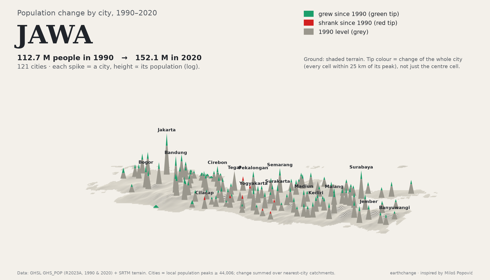
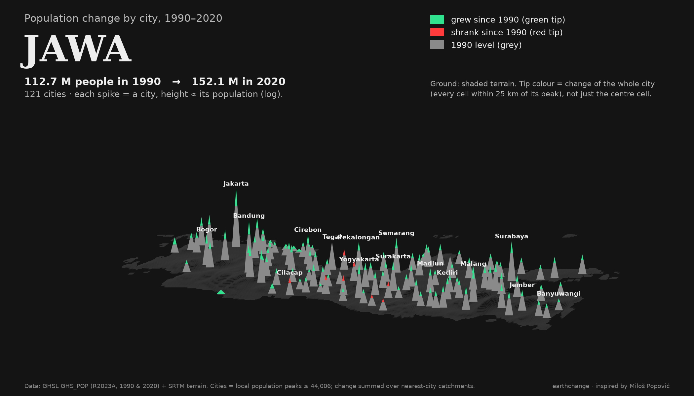
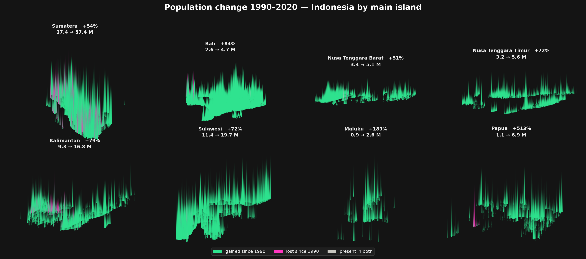
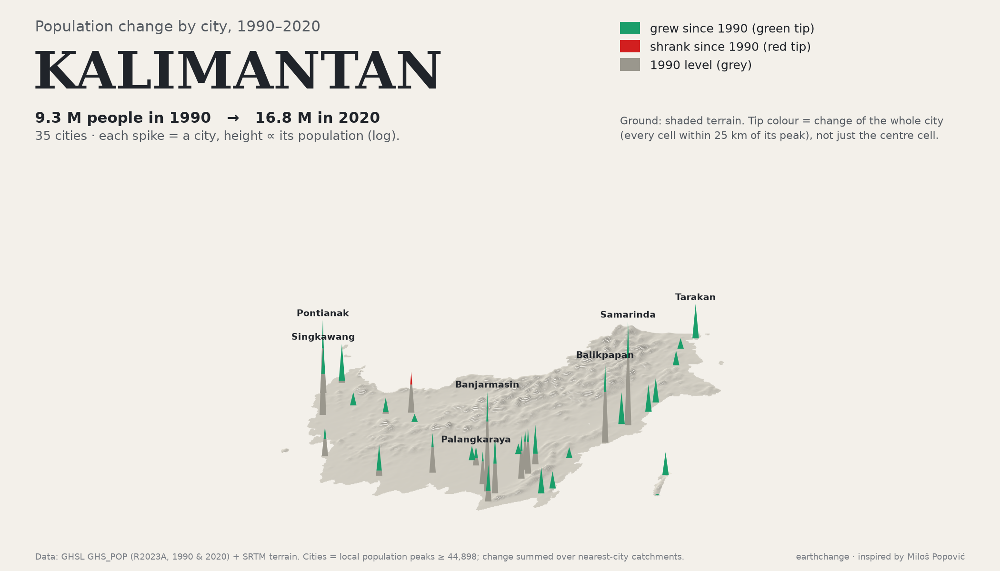

# Studi kasus: perpindahan penduduk {#sec-populasi}

Bab ini berutang pada seseorang yang tidak saya kenal.

Miloš Popović seorang kartografer yang petanya sering lewat di linimasa saya. Suatu
hari ia mengunggah sesuatu yang membuat saya berhenti menggulir: peta populasi
Eropa yang digambar bukan sebagai warna atau lingkaran, melainkan sebagai **hutan
paku-paku kecil**. Tiap paku satu kota, tingginya sebanding jumlah penduduk. Dari
kejauhan yang terlihat bukan peta, melainkan lanskap — dengan lembah kosong dan
puncak-puncak menjulang di tempat kota besar berada.

Reaksi saya waktu itu barangkali sama dengan reaksi Anda sekarang: *Indonesia kalau
digambar begini bagaimana ya bentuknya?*

Rasa penasaran semacam itu, menurut pengalaman saya, adalah bahan bakar yang sangat
baik. Ia tidak pura-pura penting. Tidak ada rumusan masalah, tidak ada urgensi
kebijakan, tidak ada tenggat. Cuma ingin tahu bentuknya. Dan justru pekerjaan yang
lahir dari rasa penasaran polos biasanya berakhir lebih jauh daripada yang direncanakan.

Yang terjadi kemudian memang begitu. Setelah petanya jadi, saya sadar Indonesia
punya cerita yang jauh lebih rumit daripada yang muat di satu gambar cantik.

Antara 1990 dan 2020, Indonesia bertambah puluhan juta jiwa. Itu bukan berita — kita
semua tahu. Angka nasional justru bagian yang paling membosankan dari cerita ini,
karena ia menyembunyikan segalanya. Yang menarik bukan **berapa**, melainkan **ke
mana**. Siapa yang tumbuh, siapa yang menyusut, dan apakah keduanya bisa terjadi di
pulau yang sama.

Bab ini membangun poster per-kota untuk Jawa lebih dulu, lalu melebar ke sembilan
gugus pulau.

## Jawa

```python
import earthchange as ec
ec.run("population-change", out_dir="population-change-jawa",
       bbox="105,-8.9,114.6,-5.8", cell_km=1, name="Jawa")
```

{#fig-jawa}

Cara membacanya begini. Tiap paku adalah satu kota yang terdeteksi otomatis sebagai
puncak populasi lokal — bukan daftar yang saya ketik sendiri. **Tingginya**
sebanding dengan jumlah penduduk kota itu pada 2020, jadi Jakarta menjulang dan
kota kecamatan nyaris rata dengan tanah. **Warna ujungnya** yang bercerita soal
perubahan: hijau berarti tumbuh sejak 1990, merah berarti menyusut. Batang
abu-abunya adalah tinggi kota itu pada 1990 — jadi bagian berwarna di ujung adalah
selisih tiga puluh tahun, terbaca langsung sebagai panjang.

Hasilnya: Jawa naik dari **112,7 juta menjadi 152,1 juta — tumbuh 35%** — dengan
**121 kota** terdeteksi. Jakarta paku tertinggi, disusul Bandung.

Yang menurut saya paling enak dilihat dari format ini adalah kepadatan pakunya
sendiri. Anda tidak perlu tahu angka apa pun untuk langsung merasakan bahwa Jawa
itu penuh. Pantai utara nyaris jadi pagar rapat dari Serang sampai Surabaya, dan
lembah-lembah di antara gunung pun terisi. Bandingkan nanti dengan gambar
Kalimantan di bawah, dan Anda akan paham kenapa perdebatan pemerataan di negeri ini
tidak pernah selesai.

Sebagian besar ujung berwarna hijau — wajar, tiga puluh tahun. Tapi ada beberapa
kota di Jawa Tengah yang ujungnya **merah**, dan itu yang layak diperhatikan.
Menyusut, di pulau yang secara keseluruhan tumbuh 35%. Peta rata-rata nasional
tidak akan pernah memperlihatkan itu; peta seperti ini memperlihatkannya tanpa
diminta.

Versi gelap tersedia kalau posternya mau dipakai untuk presentasi:

{#fig-jawa-gelap}

## Sembilan gugus pulau

Setelah Jawa jadi, pertanyaan berikutnya datang sendiri: kalau seluruh Indonesia
digambar dengan cara yang sama, siapa yang ternyata bergerak paling jauh?

```python
ec.run("population-change", out_dir="population-change-indonesia", country="Indonesia",
       regions="indonesia", cell_km=1)
```

{#fig-panel-pulau}

| Pulau | 1990 → 2020 | Perubahan |
|-------|-------------|-----------|
| **Jawa** | 114,2 → 153,3 juta | **+34%** (terbesar absolut: +39 juta) |
| Sumatera | 37,7 → 57,7 juta | +53% |
| Sulawesi | 11,4 → 19,6 juta | +72% |
| Kalimantan | 9,8 → 17,7 juta | +80% |
| Nusa Tenggara Timur | 3,2 → 5,6 juta | +72% |
| Nusa Tenggara Barat | 3,4 → 5,1 juta | +51% |
| Bali | 2,7 → 4,9 juta | +84% |
| Maluku | 1,1 → 3,1 juta | **+176%** |
| **Papua** | 1,3 → 7,7 juta | **+490%** |

{#fig-kalimantan}

Lihat gambar Kalimantan sebentar, lalu kembali ke gambar Jawa. Pola yang muncul di
Kalimantan berbeda sama sekali: pakunya tidak tersebar merata, melainkan berbaris
di **pesisir dan sepanjang sungai**. Bagian tengah pulau nyaris kosong. Ini bukan
kebetulan — itu geografi transportasi yang tercetak pada sebaran manusia. Sebelum
ada jalan, sungai adalah jalan.

Sekarang kembali ke tabelnya, dan perhatikan kolom terakhir, karena di situ ada
jebakan.

::: {.callout-important}
## Persentase saja menyesatkan
Papua **+490%**. Angka itu meloncat dari halaman, dan kalau ditaruh sebagai judul
berita, ia akan dibaca sebagai ledakan penduduk paling dramatis di Indonesia.

Tapi lihat angka mutlaknya: dari 1,3 juta menjadi 7,7 juta. Bertambah 6,4 juta orang.
Persentasenya besar karena **basisnya kecil**. Kalau sebuah kabupaten berpenduduk
seribu bertambah empat ribu, ia tumbuh 400% — mengalahkan Papua — dan tidak ada
yang perlu heran.

Sekarang lihat Jawa: **+34%**. Terdengar biasa saja, paling tidak dramatis di
seluruh tabel. Padahal itu **penambahan 39 juta orang** — lebih banyak daripada
seluruh penduduk Papua, Maluku, Bali, dan NTB **digabung**, dan itu pun masih
tersisa.

Dua angka, dua kesan yang berlawanan, dari data yang sama persis. Persentase
menyanjung yang kecil; angka mutlak menyanjung yang besar. Keduanya sama-sama
"benar", dan keduanya sama-sama tidak lengkap.

Karena itu tiap panel di gambar gabungan menampilkan **persentase dan angka mutlak
berdampingan**, dan saya sengaja tidak menyediakan opsi untuk mematikan salah
satunya.
:::

Kalau harus diringkas satu kalimat — meskipun saya baru saja bilang satu kalimat
tidak pernah cukup — begini: **Jawa menambah paling banyak orang, tetapi
pulau-pulau timur tumbuh paling cepat.** Yang pertama soal beban; yang kedua soal
laju perubahan. Pola frontier khas transmigrasi dan ekonomi sumber daya, terbaca
langsung dari data grid tanpa perlu satu pun dokumen kebijakan.

Dua kalimat itu sama-sama benar, dan sama-sama pincang kalau dikutip sendirian.
Sayangnya, yang biasanya dikutip memang cuma salah satu — tergantung argumen apa
yang sedang ingin dimenangkan.

## Catatan teknis

Bagian ini untuk yang ingin tahu isi dapurnya. Boleh dilewati kalau Anda cuma
memerlukan hasilnya — tapi bagian tengah di bawah ini bercerita tentang kesalahan
yang cukup memalukan, jadi sayang juga kalau dilewati.

**Deteksi kota.** Kota di sini bukan daftar yang saya ketik, melainkan **puncak
populasi lokal** yang dicari otomatis. Ambang batasnya diskalakan ke luas sel,
supaya jumlah kota yang terdeteksi tetap masuk akal baik pada `cell_km=1` maupun
5. Kalau tidak diskalakan, mengubah resolusi akan diam-diam mengubah definisi
"kota", dan Anda akan bingung kenapa jumlahnya berubah padahal datanya sama.

**Kenapa catchment 25 km.** Nah, ini pelajaran yang saya dapat dengan cara yang
tidak enak.

Versi pertama peta ini menilai perubahan dari **sel puncak** saja — masuk akal,
kan? Kota adalah puncaknya, jadi lihat saja bagaimana puncak itu berubah. Saya
jalankan, gambarnya keluar, dan hasilnya: **Jakarta dan Bandung tampil abu-abu**.
Tidak hijau, tidak merah. Seolah-olah selama tiga puluh tahun tidak terjadi apa-apa
di dua metropolitan terbesar Jawa.

Untuk sesaat saya benar-benar mengira ada bug di kode saya. Ternyata tidak ada bug;
yang keliru adalah definisi saya.

Inti Jakarta dan Bandung **sudah jenuh sejak 1990**. Sel di pusat kota itu sudah
penuh sebelum periode pengamatan dimulai, dan tidak bisa lebih penuh lagi. Seluruh
pertumbuhan tiga puluh tahun terakhir pindah ke pinggiran — Bekasi, Tangerang,
Depok, Cimahi, Soreang. Peta saya benar secara harfiah dan menyesatkan secara total.

Perbaikannya: menjumlahkan seluruh sel dalam radius **25 km** dari tiap puncak, dan
membagi wilayah antar kota yang berdekatan berdasarkan puncak terdekat. Begitu
diperbaiki, angkanya jadi jujur: **Jakarta +66%, Bandung +59%**.

Saya menceritakan ini panjang-panjang karena polanya berulang di luar kasus ini.
Ketika hasil analisis bertentangan dengan hal yang jelas-jelas Anda ketahui — dan
"Jakarta tumbuh sejak 1990" termasuk hal yang jelas — kemungkinan besar bukan
kenyataannya yang aneh, melainkan definisi yang Anda pakai sedang mengukur sesuatu
yang lain dari yang Anda kira.

**Kenapa terrain terpisah.** Basemap terrain dirender pada kisi halus tersendiri
(~1–3 km), sementara paku dan catchment populasi tetap pada kisi 5 km. Awalnya
keduanya satu kisi, dan akibatnya garis pantai pulau kecil seperti Bali jadi
bergerigi kasar seperti tangga.

Memisahkan keduanya membuat garis pantai halus **tanpa satu pun angka populasi
berubah** — karena yang saya perhalus cuma latar belakangnya, bukan datanya. Yang
cantik dan yang benar tidak harus saling mengorbankan; yang perlu dijaga adalah
keduanya jangan sampai tertukar.

::: {.callout-warning}
## GHS_POP adalah model
Ini yang paling penting dari seluruh catatan teknis di atas. Semua angka populasi di
bab ini berasal dari GHSL, yang bekerja dengan cara **mendisagregasi data sensus ke
grid lahan terbangun** yang dideteksi dari citra satelit. Bukan cacah jiwa per sel —
tidak ada yang mengetuk pintu di tiap kotak 1 km.

Konsekuensinya: pola redistribusi yang ditampilkan bab ini kuat dan layak dipercaya,
karena kesalahannya cenderung saling meniadakan pada skala besar. Tapi angka untuk
**satu wilayah tertentu** bisa meleset, terutama di tempat yang pola bangunannya
tidak lazim — permukiman jarang di lahan luas, atau bangunan besar berpenghuni
sedikit.

Jadi: pakai untuk melihat ke mana orang berpindah. Jangan pakai untuk menggantikan
angka BPS kabupaten Anda. Kalau keduanya berbeda, BPS yang benar.
:::
