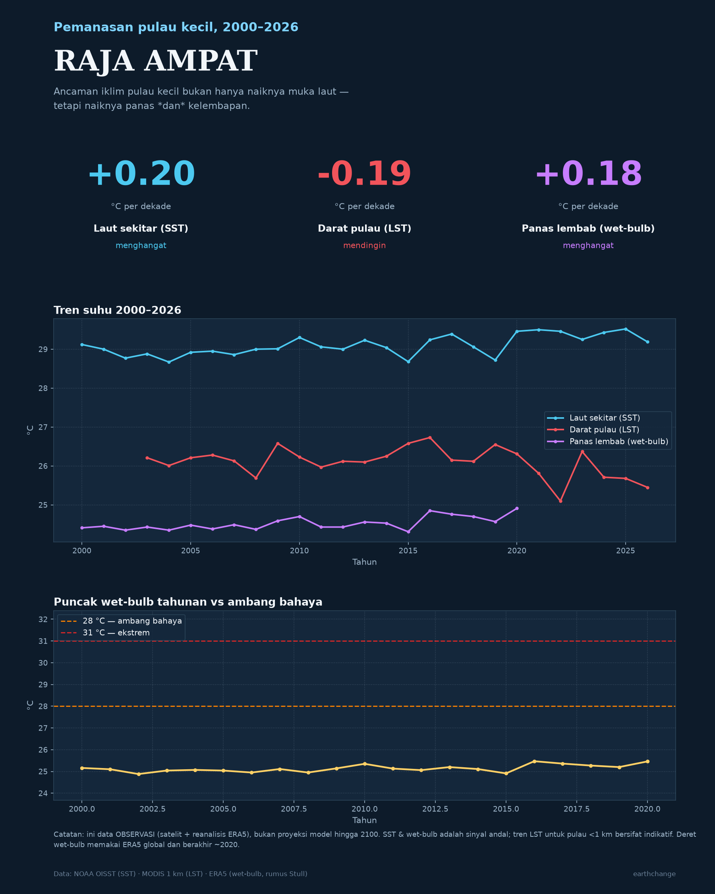

# Studi kasus: pulau kecil memanas {#sec-pulau}

Setiap kali topik pulau kecil dan iklim muncul di ruang seminar, arah pembicaraannya
hampir selalu sama: muka air laut naik, garis pantai mundur, pulau tenggelam. Ada
peta dengan garis biru merambat ke daratan, ada foto rumah yang fondasinya sudah
tergerus.

Saya paham kenapa. Gambarnya kuat, ceritanya bisa dipahami siapa pun dalam sepuluh
detik, dan — yang paling penting — itu memang benar-benar terjadi. Tidak ada yang
perlu diperdebatkan di situ.

Tapi ada ancaman lain yang jarang sekali masuk percakapan, dan menurut saya justru
datang **lebih dulu**: panas yang bercampur lembap.

Begini alasannya. Tubuh manusia mendinginkan diri dengan menguapkan keringat. Itu
satu-satunya mekanisme yang kita punya, dan ia bergantung pada satu syarat: udara di
sekitar kita harus masih sanggup menampung uap air. Di tempat kering, keringat
menguap cepat dan kita bertahan pada suhu yang sangat tinggi — orang bekerja di
gurun 45 °C. Di udara yang sudah nyaris jenuh uap air, keringat menetes tanpa
menguap, dan pendinginan itu berhenti bekerja.

Sekarang pikirkan di mana pulau-pulau kecil Indonesia berada. Di tengah laut
tropis. Kelembapannya nyaris selalu tinggi, sepanjang tahun, tanpa musim kering
yang benar-benar kering. Naik satu derajat di Semarang dan naik satu derajat di
tengah Laut Banda bukan hal yang sama.

Dan ada satu perbedaan lagi yang membuat saya merasa topik ini kurang perhatian:
kenaikan muka laut memberi waktu. Ia berjalan puluhan tahun, terlihat, bisa
diantisipasi, bisa dibangun tanggulnya. Panas lembap yang melewati ambang tidak
memberi waktu apa pun. Ia datang sebagai hari — satu hari tertentu di bulan
tertentu, ketika bekerja di luar rumah berubah dari melelahkan menjadi berbahaya.

Bab ini menunjukkan cara mengukurnya. Dan sekaligus, cara mengenali kapan hasilnya
sedang berbohong kepada Anda — karena bab ini punya satu contoh yang bagus untuk itu.

## Menjalankan

```python
import earthchange as ec
ec.run("island-heat", out_dir="island-heat-raja-ampat", lat=-0.66, lon=130.23,
       radius=40, name="Raja Ampat", lst_source="modis", start_year=2000,
       infographic=True, lang="both")
```

{#fig-rajaampat}

Saya memilih Raja Ampat bukan karena ia kasus paling ekstrem — justru bukan — tapi
karena ia mewakili banyak sekali tempat di Indonesia timur: gugus pulau kecil,
penduduk tidak padat, jauh dari stasiun pemantau mana pun, dan sangat bergantung
pada kegiatan di luar ruang. Nelayan tidak bisa bekerja dari dalam ruangan ber-AC.

## Membaca hasilnya

Tiga angka utama untuk Raja Ampat (2000–2026):

| Variabel | Tren | Arti |
|----------|-----:|------|
| **SST** (laut sekitar) | **+0,20 °C/dekade** | Laut menghangat mantap |
| **LST** (darat pulau) | −0,19 °C/dekade | Lihat catatan di bawah |
| **Wet-bulb** (panas lembab) | **+0,18 °C/dekade** | Kombinasi panas+lembap naik |

Baris pertama dan ketiga sejalan dan masuk akal: laut menghangat 0,2 °C per dekade,
dan indeks panas-lembap naik hampir sama cepatnya. Konsisten, dan sesuai dengan apa
yang diketahui secara umum tentang perairan tropis.

Sekarang baris kedua. Dan di sinilah bab ini jadi menarik.

::: {.callout-important}
## Tren LST negatif itu mencurigakan — dan memang harus dicurigai
Coba baca ulang baris kedua tabel, pelan-pelan. Daratan pulaunya **mendingin**
0,19 °C per dekade, sementara laut di sekelilingnya menghangat 0,20 °C per dekade.

Benarkah demikian? Adakah mekanisme fisik yang membuat sepetak daratan kecil
mendingin sementara samudra yang mengepungnya dari segala arah menghangat?

Hampir pasti tidak ada. Ini bukan temuan; ini artefak.

Penyebabnya begini. Satu piksel LST — bahkan pada MODIS yang beresolusi relatif
kasar — jauh lebih besar daripada banyak pulau di Raja Ampat. Artinya satu piksel
itu mencampur daratan, laut, awan tipis, dan vegetasi sekaligus, lalu melaporkan
satu angka. Dan komposisi campuran itu **berubah dari tahun ke tahun**, tergantung
awan, tergantung pasang, tergantung citra mana yang kebetulan lolos seleksi.

Jadi yang sebenarnya kita ukur bukan "suhu daratan Raja Ampat", melainkan "berapa
banyak laut yang kebetulan ikut masuk ke dalam piksel tahun ini". Trennya nyata
sebagai angka, dan kosong sebagai makna.

Inilah sebabnya buku ini berulang kali menyebut tren LST untuk pulau di bawah 1 km
sebagai **indikatif saja**. Bukan basa-basi kehati-hatian.

Yang ingin saya tekankan: godaan untuk mengabaikan peringatan semacam ini besar
sekali. Angkanya sudah ada, tabelnya sudah rapi, dan menghapus satu baris dari
tabel terasa seperti membuang hasil kerja. Apalagi kalau angka itu kebetulan
mendukung argumen yang sedang kita bangun. Saya menaruh baris ini di tabel — alih-alih
menyembunyikannya — persis supaya persoalannya kelihatan.

Yang bisa dipercaya di sini adalah **SST dan wet-bulb**. Kalau LST benar-benar
penting bagi analisis Anda, pakai `lst_source="modis"` untuk pulau yang besar, atau
perbesar radiusnya sampai daratannya cukup untuk dianalisis. Kalau tidak bisa
keduanya, lebih baik tidak melaporkan LST sama sekali daripada melaporkan angka
yang tidak berarti apa-apa.
:::

## Wet-bulb dan ambang bahaya

Panel bawah poster memplot **puncak wet-bulb tahunan** terhadap dua ambang yang
sudah cukup mapan dalam literatur fisiologi:

- **28 °C** — tubuh manusia mulai kesulitan mendinginkan diri lewat keringat.
  Bekerja berat di luar ruang jadi berisiko, terutama untuk lansia, anak-anak, dan
  orang dengan penyakit jantung atau paru.
- **31 °C** — ekstrem. Aktivitas luar ruang berbahaya bahkan bagi orang dewasa
  sehat dan terlatih, berapa pun banyaknya air yang diminum.

Perlu ditekankan bahwa ini ambang yang berbeda sifatnya dari suhu udara biasa.
Wet-bulb 31 °C tidak terdengar panas — angkanya lebih rendah daripada suhu siang
hari yang kita alami setiap hari di Jakarta. Tapi ia mengukur hal yang lain: batas
kemampuan tubuh membuang panas, bukan seberapa terik mataharinya.

Raja Ampat sekarang berada di sekitar **25,5 °C**.

Masih aman. Dan saya ingin sangat jelas soal ini, supaya tidak ada yang mengutip
bab ini seolah-olah Raja Ampat sudah dalam bahaya — belum, dan tidak dalam waktu
dekat.

Yang perlu dipantau bukan nilai hari ini, melainkan **arahnya** dan seberapa cepat
jarak 2,5 °C menuju ambang 28 °C itu menyusut. Pada laju sekarang, jaraknya masih
puluhan tahun. Tapi laju bukan janji, dan "puluhan tahun" adalah rentang waktu yang
kebetulan sama dengan umur rencana kebanyakan infrastruktur yang sedang kita bangun
hari ini.

Ada alasan kedua mencatat angka aman: supaya sepuluh tahun lagi ada yang bisa
dibandingkan. Rekaman baseline paling berguna justru ketika ia dibuat saat belum
ada apa-apa. Kalau kita baru mulai mengukur setelah keadaan memburuk, kita tidak
akan pernah tahu seberapa jauh perubahannya.

## Membandingkan beberapa gugus pulau

Satu gugus pulau saja sulit ditafsirkan. Tren +0,18 °C/dekade itu cepat atau
lambat? Dibanding apa? Perbandingan antar tempat biasanya jauh lebih informatif
daripada angka tunggal.

Jalankan terpisah, lalu bandingkan `stats.json`-nya:

```python
ec.run("island-heat", out_dir="island-heat-kepulauan-seribu", lat=-5.7, lon=106.55,
       radius=35, name="Kepulauan Seribu")
ec.run("island-heat", out_dir="island-heat-karimunjawa", lat=-5.85, lon=110.42,
       radius=25, lst_source="modis", name="Karimunjawa")
ec.run("island-heat", out_dir="island-heat-raja-ampat-2", lat=-0.66, lon=130.23,
       radius=40, lst_source="modis", name="Raja Ampat")
```

Ketiganya sengaja saya pilih berbeda karakter: Kepulauan Seribu berimpit dengan
metropolitan terbesar Indonesia, Karimunjawa relatif terpencil tapi masih di Laut
Jawa, dan Raja Ampat jauh di timur dengan massa air yang berbeda sama sekali. Kalau
ketiganya bergerak dengan laju yang mirip, itu sendiri sebuah temuan.

::: {.callout-note}
## Belum ada mode `areas` untuk island-heat
Berbeda dari `fire-history` yang bisa merakit panel gabungan lima provinsi dalam
satu perintah, `island-heat` belum punya mode banyak-wilayah. Untuk sekarang,
jalankan tiap gugus satu per satu lalu susun sendiri perbandingannya dari
`stats.json`.

Saya sebutkan keterbatasan ini terang-terangan supaya Anda tidak menghabiskan waktu
mencari opsi yang memang belum ada. Ini kandidat kuat untuk versi berikutnya.
:::

## Mode per-pulau

Kalau Anda punya poligon tiap pulau, ada cara yang lebih baik. `--island-mode
per-island` menghasilkan deret **LST terpisah untuk tiap pulau**, sementara SST dan
wet-bulb tetap dihitung regional — keduanya memang berskala jauh lebih luas
daripada satu pulau, jadi memecahnya per pulau tidak akan menambah informasi
apa pun:

```python
ec.run("island-heat", out_dir="island-heat-per-pulau", lat=-5.7, lon=106.55, radius=35,
       island_mode="per-island", islands_file="pulau.geojson")
```

Mode ini sekaligus jalan keluar sebagian untuk persoalan piksel campur yang
dibahas di atas: dengan poligon yang tegas, piksel yang jelas-jelas laut bisa
dikeluarkan dari perhitungan.

Satu hal yang perlu diketahui: mode ini **tidak** menghasilkan poster cerita. Bukan
karena belum sempat dibuat, tapi karena tidak ada satu deret gabungan untuk
diceritakan — dan poster yang memaksakan satu garis dari dua puluh pulau berbeda
akan lebih menyesatkan daripada menolong.

::: {.callout-warning}
## Batas rentang waktu
Ini yang paling mudah membuat orang salah membaca hasil, jadi tolong diperhatikan.

Deret **wet-bulb** memakai ERA5 global dan berakhir sekitar **2020**. Deret **SST**
berlanjut sampai sekarang. **LST Landsat** baru mulai 2013; **LST MODIS** mulai
2000.

Artinya keempat tren di poster itu **tidak dihitung pada rentang waktu yang sama**.
Membandingkan "+0,20 °C/dekade" milik SST dengan "+0,18 °C/dekade" milik wet-bulb
seolah-olah keduanya mengukur periode identik adalah kekeliruan yang gampang sekali
dilakukan — apalagi karena keduanya tercetak berdampingan dalam satu tabel yang
rapi.

Rentang tiap variabel tercatat di `stats.json`. Kalau angkanya akan dikutip,
sebutkan rentangnya bersama angkanya.
:::
